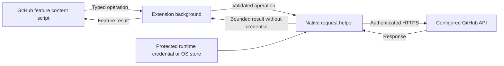

# Refined GitHub declarative credentials upstream research

Reviewed: 2026-10-09. This note investigates an upstream interface, not an
implemented patch. The existing signed extension and sealed manual-import setup
are covered by [the installation research](refined-github-token-research.md).

## Decision

Declarative credentials are technically implementable on the major desktop
browsers. A small managed-storage adapter is the most limited extension change,
but it does not provide every supported browser with declarative credentials or
keep credentials entirely out of browser storage. A native helper that performs
authenticated requests offers stronger credential isolation, with substantially
more implementation and maintenance work.

Upstream acceptance is currently unlikely for an unsolicited implementation.
The exact policy-token request already exists as
[Refined GitHub #8773](https://github.com/refined-github/refined-github/issues/8773)
and was closed as not planned on 2025-11-15. The maintainer identified managed
storage and background initialization complexity, and explicitly offered
sponsored initial development and continuing support as one possible route.
This is evidence of a conditional discussion path, not acceptance of a design.

The recommended next contribution is a discussion on that existing request,
with a narrow credential-provider proposal, explicit browser limits, synthetic
test evidence and an owner for continuing support. A global replacement of
synced settings, new OAuth service, or universal desktop/mobile promise would
expand the proposal beyond what the evidence supports.

## Source baseline and current architecture

Source was inspected at
[8098993f1e20759f4db8b47b3ab30e4fb257ea8e](https://github.com/refined-github/refined-github/tree/8098993f1e20759f4db8b47b3ab30e4fb257ea8e),
the upstream HEAD returned by GitHub on the review date. Cached web pages can
show older code, so conclusions below use raw files at that revision. The
[manifest](https://github.com/refined-github/refined-github/blob/8098993f1e20759f4db8b47b3ab30e4fb257ea8e/source/manifest.json)
requires Chrome 140, Firefox 133 and Safari 18.2. It already requests `storage`,
but has no managed schema or `nativeMessaging` permission.

[Options storage](https://github.com/refined-github/refined-github/blob/8098993f1e20759f4db8b47b3ab30e4fb257ea8e/source/options-storage.ts)
uses `webext-options-sync-per-domain`, with `personalToken` as a string array.
The locked dependencies are `webext-options-sync-per-domain` 4.3.2 and
`webext-options-sync` 4.4.0-0. The existing library provides editable, synced
options, form autosave, import, export and migrations. Managed credentials
should not enter that writable options object.

The existing
[token helper](https://github.com/refined-github/refined-github/blob/8098993f1e20759f4db8b47b3ab30e4fb257ea8e/source/github-helpers/github-token.ts)
is the natural resolution point. It takes a settings snapshot at module load,
selects a matching token for the logged-in account when several exist, and
otherwise falls back to the first token. That snapshot is unsuitable for live
credential rotation without a change to resolution or invalidation.

The
[API implementation](https://github.com/refined-github/refined-github/blob/8098993f1e20759f4db8b47b3ab30e4fb257ea8e/source/github-helpers/api.tsx)
performs authenticated REST and GraphQL fetches from feature code. It checks
token ownership before REST writes and GraphQL mutations, and memoizes requests
and ownership checks. Restricting token storage to background contexts would
therefore also require a transport change. Returning the token from a
background message handler would defeat that isolation.

Enterprise
[API URL selection](https://github.com/refined-github/refined-github/blob/8098993f1e20759f4db8b47b3ab30e4fb257ea8e/source/github-helpers/urls.tsx)
uses the page origin for `/api/v3/` and `/api/graphql`. A provider must preserve
that separation rather than supplying a GitHub.com credential to any origin
with extension permission. The
[options form](https://github.com/refined-github/refined-github/blob/8098993f1e20759f4db8b47b3ab30e4fb257ea8e/source/options.tsx)
also switches between per-domain options and dispatches input events for token
fields. Managed secrets must not be inserted into those autosaved inputs.

## Prior decisions that constrain a proposal

The following history distinguishes merged work, rejected proposals and related
standards work. It should accompany any renewed discussion of #8773.

| Discussion | Outcome and implication |
| --- | --- |
| [#8773, policy token/file request](https://github.com/refined-github/refined-github/issues/8773#issuecomment-3535466960) | Closed as not planned, 2025-11-15. Maintainer cited managed-storage initialization and background state; suggested waiting for APIs, maintaining a private version, or sponsoring initial and ongoing work. |
| [#6448, options import/export](https://github.com/refined-github/refined-github/pull/6448#discussion_r1161313001) and [#6521, exclude access token from exports](https://github.com/refined-github/refined-github/issues/6521) | Import/export merged; token-exclusion customization was declined as added complexity. #6521 closed. Excluding a new external provider from the existing options object is narrower than changing every manual-token export. |
| [#8343, token security discussion](https://github.com/refined-github/refined-github/issues/8343) and [#8344, password input PR](https://github.com/refined-github/refined-github/pull/8344) | Input masking was not treated as storage protection. The maintainer explained the trust and maintenance cost of a centralized OAuth application; the password-input PR was rejected. Avoid presenting UI masking or a hosted authentication service as the solution. |
| [#10121, multiple-token preparation](https://github.com/refined-github/refined-github/pull/10121) and [#10131, multiple-account support](https://github.com/refined-github/refined-github/pull/10131) | Merged in September 2026. Current token arrays and account selection are real requirements; a new provider must preserve them. The review also addressed dependency cycles. |
| [#10014, token widget storage integration](https://github.com/refined-github/refined-github/issues/10014) | Discussion opposed direct OptionsSync access in token widgets. Keep shared resolution and library integration coherent rather than adding separate widget storage logic. |
| [#10163, legacy token fallback](https://github.com/refined-github/refined-github/pull/10163) and [webext-options-sync #83](https://github.com/fregante/webext-options-sync/pull/83) | The extension fallback was rejected in favor of fixing shared library behavior. The library's array-valued options change merged on 2026-10-04; this research did not run its migration tests. |
| [#6956, fine-grained token support](https://github.com/refined-github/refined-github/pull/6956), [#6092](https://github.com/refined-github/refined-github/issues/6092), and [#8137](https://github.com/refined-github/refined-github/pull/8137) | Initial acceptance of tokens did not become complete fine-grained permission support. #8137 later removed dedicated UI treatment and marked unknown scopes. Credential delivery cannot fix token capability limits. |
| [#7798, user capability detection](https://github.com/refined-github/refined-github/pull/7798) and [#7905, subsequent token fixes](https://github.com/refined-github/refined-github/pull/7905) | Merged fixes document regressions affecting tokenless use and Enterprise scope handling. Preserve existing page-only behavior and avoid making every page wait for credential validation. |

### Additional configuration and credential history

The surrounding threads explain how earlier requests became shared-library
features and why host/account isolation matters. All were reviewed as part of
the relevant-history investigation.

| Thread | Recorded result and relevance |
| --- | --- |
| [#2120](https://github.com/refined-github/refined-github/issues/2120), 2019 | Textual feature lists across profiles were declined in favor of native sync and the checkbox UI. Niche configuration controls face a high product bar. |
| [#2726](https://github.com/refined-github/refined-github/issues/2726), 2020, and [#3981](https://github.com/refined-github/refined-github/issues/3981), 2021 | Dotfiles/offline/cross-profile import requests were directed to [webext-options-sync #23](https://github.com/fregante/webext-options-sync/issues/23). Console workarounds were suggested before a supported UI existed. |
| [webext-options-sync #65](https://github.com/fregante/webext-options-sync/pull/65) and [#6518](https://github.com/refined-github/refined-github/pull/6518), 2023 | Shared import/export eventually landed; the initial Chromium file-picker implementation needed a subsequent Firefox/Safari adaptation. Cross-browser release work is part of the feature. |
| [#7688](https://github.com/refined-github/refined-github/issues/7688), [library #76](https://github.com/fregante/webext-options-sync/pull/76), and [#7703](https://github.com/refined-github/refined-github/pull/7703), 2024 | Domain-specific import/export listener lifetime required fixes. An origin switch must not reuse old credential validation or export state. |
| [#7735](https://github.com/refined-github/refined-github/issues/7735), 2024 | Reported Safari token overwrites between public and Enterprise domains. Browser differences and release lag were discussed; closed status alone is not proof of a fix. |
| [#6640](https://github.com/refined-github/refined-github/pull/6640), 2023 | Basic fine-grained input acceptance merged before later UI changes. Input acceptance is distinct from complete permission support. |
| [#8614](https://github.com/refined-github/refined-github/issues/8614), 2025, and [#8686](https://github.com/refined-github/refined-github/issues/8686), 2025 | Requests revisited fine-grained support and OAuth alternatives. Maintainers reiterated current limits and reluctance to run a server; a claimed GitHub PAT deprecation was corrected as an npm-token announcement. |
| [#7444](https://github.com/refined-github/refined-github/pull/7444), 2024, and [#8692](https://github.com/refined-github/refined-github/issues/8692), 2025 | CLI OAuth token input is supported. Such credentials are not necessarily short-lived and there is no existing automatic refresh integration. |
| [#6446](https://github.com/refined-github/refined-github/issues/6446), 2023-2025, and [#8436](https://github.com/refined-github/refined-github/issues/8436), 2025-2026 | Multiple-token support moved from rejection to willingness to accept a complete implementation preserving the single-token experience, then release in v26.10. This demonstrates changed decisions, not acceptance of managed credentials. |
| [#9193](https://github.com/refined-github/refined-github/issues/9193), 2026 | URL/organization token routing was closed after agreement that logged-in account selection sufficed. Avoid expanding managed credentials into a general routing engine. |
| [#9681](https://github.com/refined-github/refined-github/issues/9681) and [#10059](https://github.com/refined-github/refined-github/issues/10059), 2026 | Additional container/multiaccount requests were closed. Their bodies were reviewed; the API returned no comments. |
| [#7384](https://github.com/refined-github/refined-github/issues/7384), 2024, [#9118](https://github.com/refined-github/refined-github/issues/9118), and [#9129](https://github.com/refined-github/refined-github/pull/9129), 2026 | Write identity protection was discussed and centralized. The maintainer opposed an optional strict-write setting. A new provider must retain mandatory ownership checks. |
| [#10054](https://github.com/refined-github/refined-github/pull/10054), 2026 | Follow-up to #10014 addresses stale token validation side effects. Framework handling of obsolete promises is not sufficient evidence that no token reached the wrong host. |
| [#10175](https://github.com/refined-github/refined-github/pull/10175), 2026-10-09 | The add-account UI was restricted to valid tokens. Current UI behavior should be preserved when adding managed status. |

The project
[contribution guide](https://github.com/refined-github/refined-github/wiki/Contributing)
asks contributors to obtain discussion and acceptance before submitting new
feature PRs. Its
[feature policy](https://github.com/refined-github/refined-github/wiki/%22Can-you-add-this-feature%3F%22)
emphasizes low complexity and avoiding external servers. Credential plumbing
is infrastructure rather than an ordinary page refinement, but that distinction
does not imply the maintainer will accept extra maintenance.

### Browser API discussions behind the rejection

[W3C WebExtensions #547](https://github.com/w3c/webextensions/issues/547)
remains open. It describes a managed-storage initialization problem where an
empty result cannot reliably distinguish absent policy from policy not yet
loaded, and initialization may not produce an event. Chromium feedback did not
establish a universal fix; observations differed across operating systems and
enterprise installation environments. A fixed startup delay is not proof that
the policy is ready.

[W3C #703](https://github.com/w3c/webextensions/issues/703) also remains open.
It concerns synchronously available state across background restarts. This is
relevant to ergonomic background initialization, but it is not a prerequisite
for every asynchronous provider. Chrome already documents
[awaiting asynchronous storage reads inside registered event handlers](https://developer.chrome.com/docs/extensions/reference/api/storage#asynchronous-preload-from-storage).
A request-time provider can work with existing APIs. That is an implementation
inference, not resolution of #547 or agreement with the maintainer.

[W3C #497](https://github.com/w3c/webextensions/issues/497) describes differences
in managed-schema support and validation. Chrome requires a shipped schema;
Firefox does not enforce that schema. The extension consequently needs its own
runtime validation rather than assuming the browser validated credentials.

## Actual cross-browser reach

The [README](https://github.com/refined-github/refined-github/blob/8098993f1e20759f4db8b47b3ab30e4fb257ea8e/readme.md#install)
advertises Chromium browsers, Firefox including Android, and Safari on Mac,
iOS and iPadOS. Capability evidence comes from pinned
[MDN storage data](https://github.com/mdn/browser-compat-data/blob/3b28abed321540dcbe571c16174af543c4e02ac0/webextensions/api/storage.json)
and
[runtime data](https://github.com/mdn/browser-compat-data/blob/3b28abed321540dcbe571c16174af543c4e02ac0/webextensions/api/runtime.json),
not live tests on every product.

| Browser | Managed credentials | Native helper | Important qualification |
| --- | --- | --- | --- |
| Desktop Firefox | Supported | Supported | Managed changes require restart; no `setAccessLevel` protection. |
| Zen | Expected Firefox behavior | Expected Firefox behavior | Manifest lookup and packaging require actual distribution tests. |
| Desktop Chrome | Supported | Supported | Managed schema required; managed values have a browser disk cache. |
| Desktop Edge | Compatibility data mirrors Chrome | Supported according to compatibility data | Test the extension ID, release channel and policy backend. |
| Desktop Brave | Chromium policies documented | Expected Chromium behavior | Vendor-specific integration still needs tests. |
| Opera | Compatibility data explicitly says unsupported | Compatibility data mirrors Chrome | Chromium ancestry alone does not establish managed-policy support. |
| Firefox Android | Unsupported | Unsupported for ordinary extensions | Requires a different provisioning solution. |
| Safari macOS | Unsupported | Through its containing app | Cannot use an independently installed desktop host directly. |
| Safari iOS/iPadOS | Unsupported | Through its containing app | App sandbox and device provisioning require separate native work. |

[Brave's documentation](https://support.brave.app/hc/en-us/articles/360039248271-Group-Policy)
supports the Chromium policy statement above. Safari native messaging is
documented by
[Apple](https://developer.apple.com/documentation/safariservices/messaging-between-the-app-and-javascript-in-a-safari-web-extension).
Safari ignores the requested native application ID and routes messages to its
own containing app extension. A shared desktop host registration therefore
cannot supply Safari credentials. Firefox Android also prevents a universal
native-host solution for the ordinary store extension.

All supported browsers can retain their existing manual behavior while capable
ones gain a provider. That is cross-browser compatibility with uneven
declarative capability. Claiming automatic provisioning everywhere would be
incorrect without additional platform implementations or new browser APIs.

## Security properties and limits

The intended improvement is to reduce accidental token replication and account
confusion while keeping configuration repeatable. It cannot make an untrusted
extension trustworthy or protect a plaintext runtime file from arbitrary
processes running as its owner. A broker also retains authority to perform API
operations; keeping its token private does not prevent abuse of an overbroad
request interface. These are design limits, not evidence of a new vulnerability.

### Managed storage is configuration, not a vault

For Firefox, prefer a private runtime-rendered
[native managed manifest](https://developer.mozilla.org/en-US/docs/Mozilla/Add-ons/WebExtensions/Native_manifests)
over a token-bearing `3rdparty` enterprise policy. File ownership and directory
permissions can restrict other OS users. Firefox's
[policy viewer](https://github.com/mozilla-firefox/firefox/blob/7af81fe47ac81825fa31f451dddfaeb736e109ba/browser/components/enterprisepolicies/content/aboutPolicies.js)
serializes active policy values, so a native manifest also avoids that policy
diagnostic object. Its
[storage implementation](https://github.com/mozilla-firefox/firefox/blob/7af81fe47ac81825fa31f451dddfaeb736e109ba/toolkit/components/extensions/parent/ext-storage.js)
reads policy first, then a native manifest, with in-memory managed-data caching.
This source observation does not prove every Firefox build leaves no disk trace.

Chrome policy configuration uses
[platform-specific backends](https://www.chromium.org/administrators/configuring-policy-for-extensions/).
A system-wide personal token can reach multiple browser profiles and may be
readable by other OS users if file permissions are too broad. Cloud policy
distribution adds administrators and policy infrastructure to the trust model.
A general configuration-management example must not publish a usable PAT in
a shared policy directory.

Current Chromium provides a useful diagnostic mitigation. A schema can mark a
credential-bearing property `sensitiveValue: true`; its
[schema parser](https://github.com/chromium/chromium/blob/7073f2fae5868e830f8d24a78635ef63e91255e5/components/policy/core/common/schema.cc)
recognizes the attribute, and
[extension policy conversion](https://github.com/chromium/chromium/blob/7073f2fae5868e830f8d24a78635ef63e91255e5/chrome/browser/policy/chrome_policy_conversions_client.cc)
passes the schema to
[masking logic](https://github.com/chromium/chromium/blob/7073f2fae5868e830f8d24a78635ef63e91255e5/components/policy/core/browser/policy_conversions_client.cc).
This should be tested with a synthetic credential in policy views and exports.
Masking does not encrypt the underlying value.

Crucially, Chromium's
[managed store cache](https://github.com/chromium/chromium/blob/7073f2fae5868e830f8d24a78635ef63e91255e5/chrome/browser/extensions/api/storage/managed_value_store_cache.cc)
creates a persistent settings store, and its
[policy value store](https://github.com/chromium/chromium/blob/7073f2fae5868e830f8d24a78635ef63e91255e5/chrome/browser/extensions/api/storage/policy_value_store.cc)
writes the current policy to that backing store. Keeping the source policy on
volatile storage cannot guarantee a volatile-only credential in Chromium.

### Content-script isolation is browser-specific

[Chrome's storage API](https://developer.chrome.com/docs/extensions/reference/api/storage)
supports restricting managed access to trusted contexts with `setAccessLevel`.
Current compatibility data places all-area support at Chrome 140, matching the
upstream minimum version. Await that restriction before accessing credentials.
It does not help if the background then returns the PAT to content scripts.
The default permits content-script access before a restriction has been set.
First-install and upgrade behavior must therefore be tested; ordering the
provider's own read after the restriction does not establish an uninterrupted
browser-enforced boundary throughout initialization.

Firefox exposes managed storage to the extension's content scripts and lacks
this restriction. Its
[storage schema](https://github.com/mozilla-firefox/firefox/blob/7af81fe47ac81825fa31f451dddfaeb736e109ba/toolkit/components/extensions/schemas/storage.json)
supports that conclusion. Reading a raw managed token only in production
background code does not create an enforced background-only boundary there.
This does not give ordinary webpage JavaScript direct access to extension
storage.

If keeping the PAT out of all browser storage and content-script contexts is a
requirement, use a native request broker. Put only its nonsecret configuration
in browser policy, and keep the credential in the external protected store.
That has stronger potential isolation, but adds a privileged protocol requiring
careful review and testing.

## Proposed implementation contract

The following is a design proposal. Its API names are illustrative and have
not been accepted or implemented upstream.

### A bounded first contribution

Introduce one shared credential resolver at the existing token-helper boundary.
Keep manual options unchanged. Add a read-only managed provider with a versioned
policy contract and exact origin/account bindings. Do not route the complete
editable options system through `storage.managed`; migrations, form autosave
and export have writable-storage assumptions.

The provider should report a typed state: unavailable, unmanaged, pending,
ready, explicitly disabled, or configuration error. These states must remain
distinct. Once an origin is known to be managed, an empty, removed, expired or
invalid managed credential must not silently reactivate an older manual PAT.
Return to manual mode only through a documented configuration transition.
Nonsecret remembered provider intent can help across restarts, but cannot
resolve the first-install race in #547 by itself.

Required behavior is as follows.

1. Validate schema version, size limits, token type and exact HTTPS origins in
   extension code on every browser. Reject duplicate or ambiguous bindings.
   Chrome's schema validation is an additional check, not the shared validator.
2. Bind credentials to the configured GitHub or Enterprise origin and expected
   account. Verify token ownership with the appropriate `/user` API. Preserve
   existing write checks and never use a GitHub.com fallback for Enterprise.
3. Resolve credentials separately from synced settings. Never copy a managed
   PAT into `personalToken`, migrations, imports, form values, option exports,
   persistent extension caches or debug output. Existing manually stored PATs
   remain a separate legacy source and can still appear in existing exports.
4. Show source, account and status in the options UI without the managed token
   value. Disable the relevant manual input while managed credentials apply.
   Keep token widget and import logic integrated through the shared interface.
5. Register background listeners synchronously and await readiness inside the
   handlers. Avoid treating a module-level promise as a permanent credential
   snapshot. Preserve page-only features while credential-dependent operations
   wait or show a specific configuration error.
6. Handle Chromium policy changes and invalidate token selection, ownership
   checks and credential-dependent API caches. Firefox requires browser restart
   after manifest changes. Document the difference rather than claiming live
   rotation in Firefox.
7. Make delayed policy loading an explicit installation test. Bounded retries
   may improve behavior but cannot prove policy absence. An absolute guarantee
   against first-install fallback in every enterprise environment is currently
   not justified by browser APIs. State supported deployment conditions.

This change is technically feasible using existing APIs. Its scope includes a
resolver, validation, managed schema, options status, initialization/rotation
handling, tests and administrator documentation. The security guarantee is
limited to avoiding extension-created sync/export copies and incorrect
credential selection. Browser-managed persistence and Firefox content-script
access remain.

### Stronger alternative for strict credential isolation

For the stricter requirement, introduce an authenticated-request transport
behind the central REST/GraphQL helper. The extension background forwards
validated operation messages to a native helper. The helper resolves the
configured credential and performs the HTTPS request itself; neither the PAT
nor its Authorization header is returned to the browser.

[Chrome's security guidance](https://developer.chrome.com/docs/extensions/develop/security-privacy/stay-secure)
requires treating content-script messages as potentially hostile. Its
[network guidance](https://developer.chrome.com/docs/extensions/develop/concepts/network-requests)
warns against arbitrary-URL fetch proxies. Both the background and native
helper must enforce the protocol, rather than trusting request fields.

The native protocol should allow only configured GitHub API origins, bounded
operation types, permitted methods and response sizes. Reject caller-supplied
Authorization headers, arbitrary native host names, filesystem paths, shell
commands and cross-origin redirects. The background validates browser-provided
sender identity, actual frame origin and host permission. The native helper
checks its extension caller, configured destination/account and token ownership.
It cannot independently inspect the browser frame or current website login;
GitHub's `/user` response proves credential ownership, not the active page's
identity. DOM-derived account names must not themselves authorize a more
privileged operation. If read-only mode
is offered, GraphQL must be validated as an operation, not classified by a
fragile string-prefix check.

Preserve pagination headers, status codes, text/base64 response formats,
GraphQL error behavior and account checks. Native transport changes are not a
one-line replacement of `fetch`. Chrome's
[native protocol](https://developer.chrome.com/docs/extensions/develop/concepts/native-messaging)
limits individual host responses to 1 MiB, so large API results require an
explicit bounded transfer strategy. Do not automatically retry mutations after
a transport failure, since the server may already have executed them.

The helper must securely open only installer-configured credential locations,
check ownership and permissions, handle atomic secret-generation changes, and
avoid printing credentials. Browser host manifests allow only the official
extension IDs. Desktop
[Mozilla native messaging](https://developer.mozilla.org/en-US/docs/Mozilla/Add-ons/WebExtensions/Native_messaging)
can use optional permission; an explicit grant may prevent completely unattended
personal installation. Mandatory permission would expand the default extension
trust surface and needs maintainer approval.

Safari needs an adapter in the extension's containing native app, with its own
credential storage and provisioning. Firefox Android still lacks the ordinary
native API. The extension's common transport can accommodate those differences,
but an architecture diagram alone does not solve mobile provisioning.

The broker is a materially larger contribution with a separate native release
and support obligation. It best matches a strict no-browser-PAT requirement on
desktop, but it also has the greater upstream acceptance obstacle.

## Credential permissions and migration

Declarative delivery must not request broader GitHub scopes. Prefer a dedicated,
expiring token for isolation from unrelated Nix or CLI access. The current
[upstream security guide](https://github.com/refined-github/refined-github/wiki/Security)
still says fine-grained tokens are unsupported. Some may authenticate without
covering every API operation; that compatibility work should be a separate
proposal rather than silently upgrading users to a broad classic PAT.

Existing manual tokens and exports must continue working during a provider
rollout. Entering managed mode does not remove old synced copies or server-side
sync history. Offer clear instructions for removing the old manual token and
rotating it if replication was unwanted. Do not copy it into a new persistence
area as an automatic convenience migration. The previous export discussion
also argues against bundling a global manual-token export change into this work.

For a Nix integration, public configuration selects the provider and defines
nonsecret bindings. Nix-seal renders only the runtime secret material. A managed
implementation renders browser-specific policy/manifest data with real JSON
escaping. A broker implementation instead lets the helper read the protected
runtime secret directly. Neither places the credential in a Nix derivation,
Git file, command argument or ordinary Home Manager text file.

## Verification required before calling it high quality

Use synthetic credentials and isolated browser profiles. No real PAT is needed
for storage, diagnostic, message-boundary or rotation tests.

| Area | Required evidence |
| --- | --- |
| Resolver | Absent API/manifest, delayed initialization, malformed policy, explicit disablement, duplicates, account mismatch and exact origin separation. |
| Persistence | Managed sentinel absent from synced options, imports, exports, form autosave, logs and extension-controlled caches. Inspect the browser's own managed cache separately. |
| Initialization | Cold installation, force installation, browser restart and MV3 worker termination. Test policy arriving after an initial empty read. |
| Rotation | Change, removal and revocation during open pages. Confirm no stale manual fallback, ownership result or response cache survives the transition. |
| Browser policy | Firefox manifest and restart; Chrome schema acceptance, trusted-context restriction including its first-install/upgrade window, and sensitive-value masking in policy views/exports; separate Edge, Zen and vendor tests. |
| Unsupported browsers | Safari, Firefox Android and missing Chromium policy backends retain existing behavior without exceptions or misleading managed status. |
| API behavior | Public/private REST and GraphQL, Enterprise, multiple accounts, headers/pagination, errors, rate limits and response formats. |
| Native broker | Reject forged senders, unauthorized origins, redirects, command/file requests, token headers, oversized messages and malformed GraphQL operations. Never return credentials. |
| Compatibility | Existing manual import/export and token-array migration remain intact. DOM-only features do not depend on successful provider initialization. |

Current upstream scripts run Vitest, lint and browser build targets through
[its package scripts](https://github.com/refined-github/refined-github/blob/8098993f1e20759f4db8b47b3ab30e4fb257ea8e/package.json).
Those checks supplement real policy and browser lifecycle tests; mocks cannot
prove OS provisioning or policy initialization behavior.

## Implementation and acceptance assessment

| Proposal | Technical feasibility | Upstream outlook |
| --- | --- | --- |
| Read-only managed credential provider on capable desktops | Feasible now; browser initialization and persistence limits require explicit handling. | Low for an unsolicited PR because #8773 was declined; renewed scoped discussion and funded support may change the answer. |
| Same provider automatically provisioning every supported browser | Not achievable with managed storage alone. | Do not promise this as the deliverable. |
| Native request helper for desktop Firefox/Chromium | Feasible, but requires API transport changes, protocol review, permission grants and native releases. | Low without prior agreement and a support owner; broader than the declined request. |
| Safari native adapter | Technically plausible through the containing app. | Separate implementation and distribution agreement needed. |
| Universal desktop/mobile declarative setup | Requires additional platform-specific provisioning or browser API work. | Not a credible small upstream patch today. |

These outlooks are qualitative inferences from the recorded discussions, not
probabilities or maintainer commitments. The strongest contribution path is to
first agree on whether the desired guarantee is merely repeatable provisioning
without sync/export copies, or strict avoidance of browser-resident PATs. Those
are different implementation scopes.

A renewed discussion can be framed as: a read-only credential source independent
of editable options; exact origin/account binding; no external server; no added
GitHub scopes; synthetic tests for initialization and rotation; existing manual
behavior on unsupported browsers; and an explicit support commitment. If the
strict isolation guarantee is required, discuss the native request transport
and its platform exclusions before promising an implementation.

## Research coverage and limits

Research searched open and closed GitHub issues and PRs, followed linked review
threads and standards discussions, and inspected pinned extension/browser
source. GitHub REST searches used `repo:refined-github/refined-github` with
`managed`, `declarative`, `storage.managed`, `managed storage`, `native messaging`,
`nativeMessaging`, `policy`, `policies`, `OAuth`, `fine-grained`, `Nix`, and
token combinations with `sync`, `security`, `secure`, `local`, `export` and
`encrypt`. Title searches covered configuration, import, managed, secret,
storage sync, and older token requests. Linked dependency issues, PR review
comments and review summaries were followed. Relevant comment responses fit
within the requested 100-comment page; broad search results can exceed a page
and contain unrelated feature bugs. Repository metadata reports no enabled
GitHub Discussions forum.

The relevant inventory is above; private, deleted, unindexed or
otherwise inaccessible discussions cannot be ruled out. Finding no additional
request is not proof that none exists.

No extension implementation, browser-policy experiment, real credential test,
upstream comment or pull request was performed. Source-derived behavior and
compatibility records are distinguished from proposed guarantees. Documentation
checks validate this note, not a working provider. The existing deployment was
not changed by this investigation.
